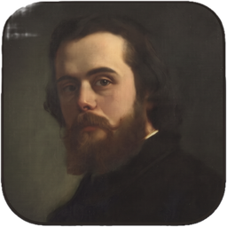
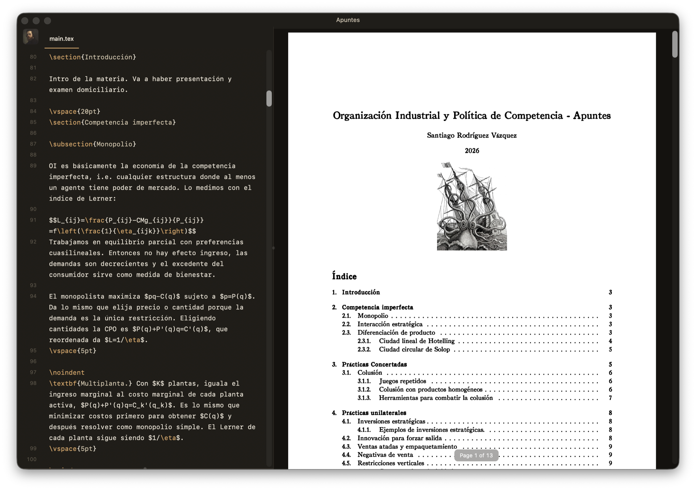
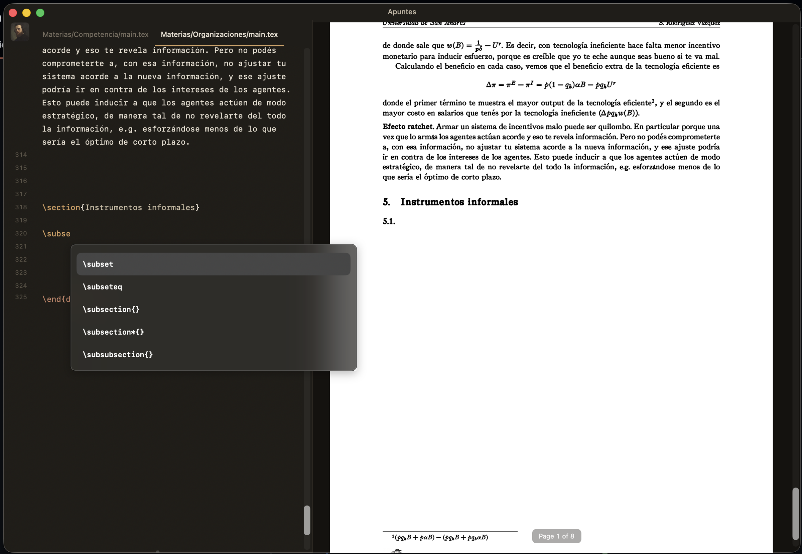
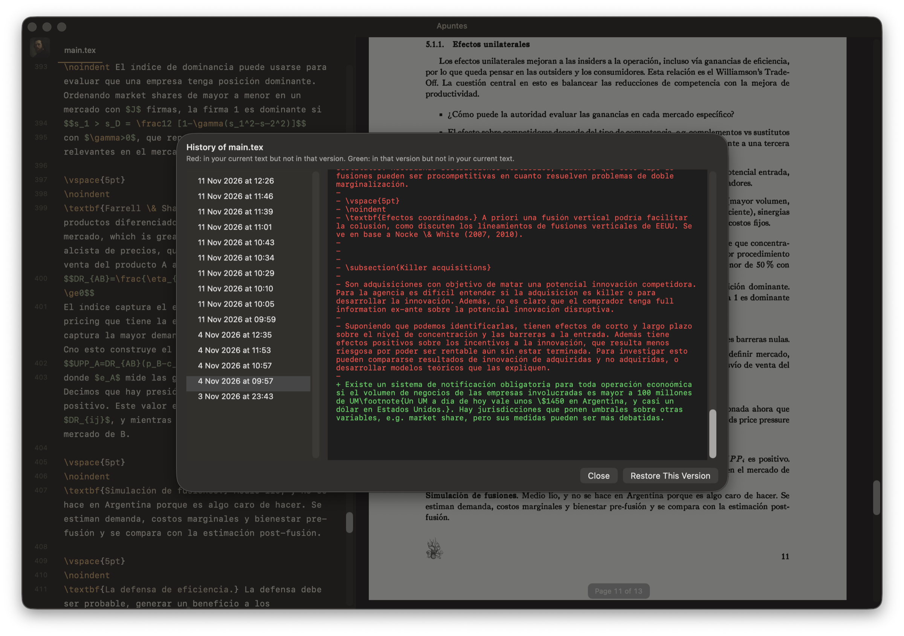
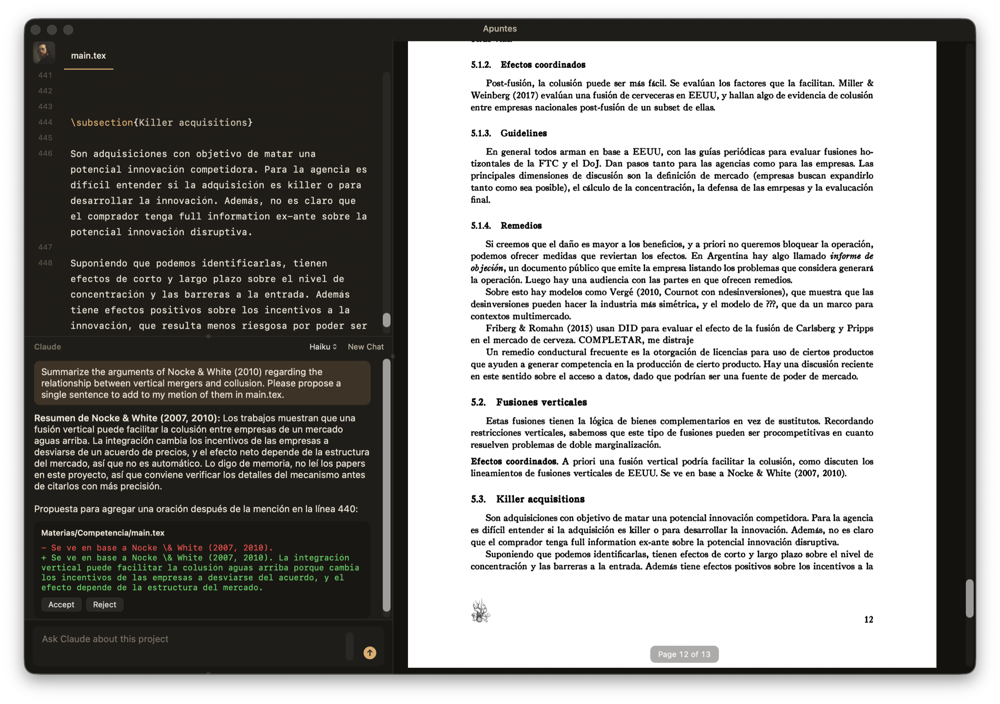

  

<h1 align="center">Walras</h1>

  <b>Overleaf, but on your Mac.</b> 
  A native LaTeX editor: write on the left, read the PDF on the right, recompile with ⌘R. Nothing in the cloud.

  
  
  

  

Walras opens any folder with `.tex` files as a project. It uses the TeX distribution already on your Mac and keeps the folder clean: auxiliary files, logs and the PDF are built in a temporary directory, never next to your sources. Its sibling, [Jevons](https://github.com/sanarovaz/jevons), is the paper library it cites from.

---

## Features

### Write
- **Tabs in two columns.** Code and PDF side by side, or two files at once; drag tabs between columns. **⌘P** jumps to any file by typing part of its name.
- **Outline** of sections across `\input` and `\include` (⌥⌘2), **find in the whole project** (⇧⌘F), spell checking in Spanish or English.
- **Paste an image** and Walras saves it in the project and writes the `\includegraphics` for you.
- **Focus mode** (⇧⌘↩) hides everything but the text.
- **Copy as image** (⌃⌘C): select an equation or a table and get a cropped, high-resolution PNG, also in a dark version (⌃⇧⌘C), ready for slides or a message.

### Complete as you type

- Commands, including the ones you define with `\newcommand`, and environments, including your own theorems and boxes.
- `\ref{}` and `\eqref{}` from every `\label` in the project, with the line it lives on.
- `\cite{}` from the project's `.bib` **and from your Jevons library**: a paper you haven't cited yet is added to the bibliography when you pick it.
- File names in `\input`, `\includegraphics` and `\bibliography`.
- **⇧⌘B**: type a paper's title or authors, press return, and its entry is added to the bibliography from Crossref. **Zotero** sync (⌥⌘Z) talks only to the Zotero app on your Mac.

### Compile
- **⌘R** recompiles, **⇧⌘R** from scratch; optionally compile on every save.
- **⌘-click the PDF** to jump to the line that produced it (SyncTeX).
- Errors are shown readably; **⇧⌘E** copies them, to paste into a question.
- An up-to-date PDF, named after the document's `\title`, is kept next to each document that changed, every hour and when you quit.

### Never lose a version

- **Version history** (⇧⌘H): automatic copies of every file, kept in Application Support and never in the project. The last day is kept in full; older versions thin out to one per hour, then one per day.
- **Push to GitHub** (⇧⌘U) with the git and the credentials already on your Mac.

### Claude, inside the project

- **⌥⌘C** opens a Claude panel that knows what you're looking at: the file, the selection, the last compile errors.
- It runs the **Claude Code you installed and signed in to**, one process per turn; Walras stores no keys.
- Claude can't write files. It **proposes** edits (to the text, or new folders and moves), shown as cards; **only Walras applies them, and only once you accept**. Conversations are kept in Application Support, outside the project.

### With Jevons
- Citation completion draws on the Jevons library, and Walras asks Jevons to add the papers it doesn't have.
- **⌥⇧⌘J** opens the paper under the cursor in Jevons.
- Walras tells Jevons where each key is cited, so Jevons can show “✓ cited” and take you back to the line.

---

## Keyboard

| | |
|---|---|
| ⌘R · ⇧⌘R | Recompile · from scratch |
| ⌘P | Quick open a file |
| ⇧⌘F | Find in the project |
| ⇧⌘B | Add a reference from Crossref |
| ⌥⌘C | Claude panel |
| ⇧⌘H | Version history |
| ⇧⌘U | Push to GitHub |
| ⌘L · ⇧⌘E | Show the log · copy the errors |
| ⌃⌘C | Copy the selection as an image |
| ⇧⌘↩ | Focus mode |
| ⌥⌘1 · ⌥⌘2 | Files · outline |
| ⌃⇥ · ⌃⇧⇥ | Next · previous tab |
| ⌥⇧⌘J | Open the cited paper in Jevons |

## Build

Walras is a plain Swift/AppKit app with no dependencies and no Xcode project.

1. Install Apple's command-line tools once: `xcode-select --install`.
2. Install a TeX distribution such as [MacTeX](https://www.tug.org/mactex/) or BasicTeX.
3. Double-click **`Compilar Walras.command`**. It compiles, signs locally and installs `~/Applications/Walras.app`.

Requires macOS 13 or later. The interface is in Spanish on a Mac set to Spanish, and in English otherwise. Themes are shared with Jevons: Walras (light and dark), Oil, Paper, Nord and Solarized.

---

Named after <a href="https://en.wikipedia.org/wiki/L%C3%A9on_Walras">Léon Walras</a>. Made by <a href="https://sanarovaz.github.io">Santiago Rodríguez Vázquez</a>.

